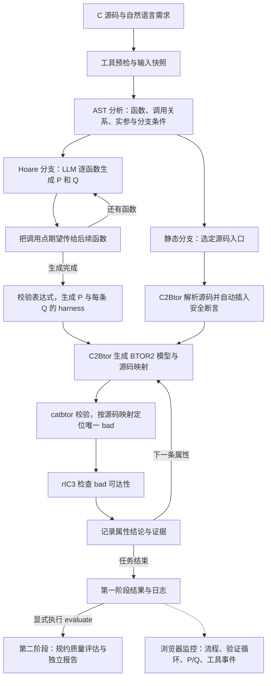
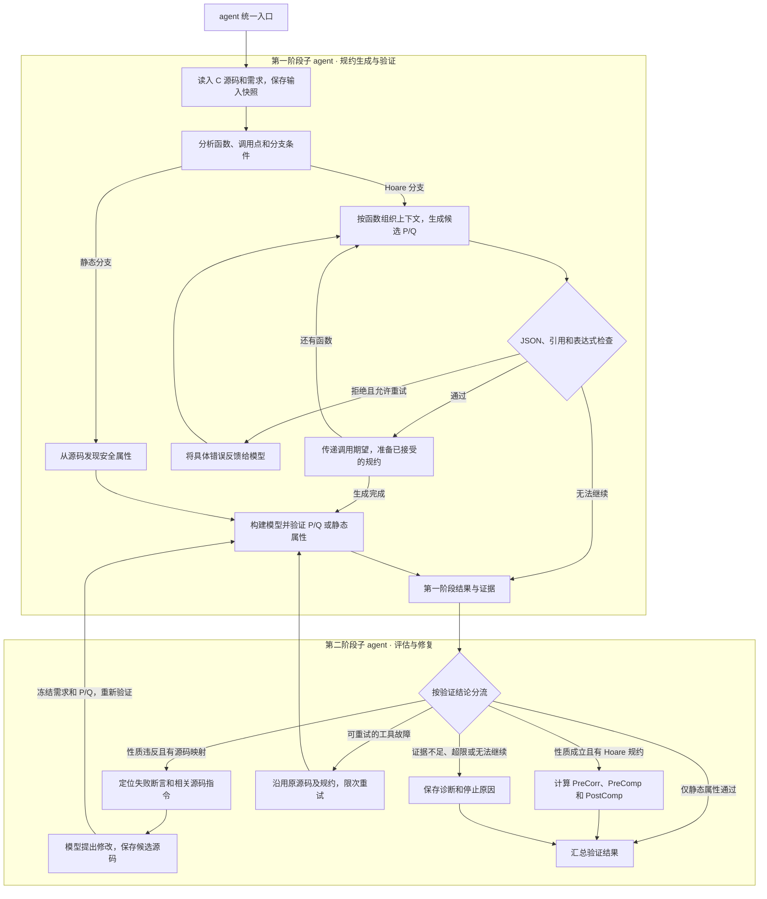

# SpecAgent · C 程序规约生成与验证

SpecAgent 从 C 源码和自然语言需求生成函数级 Hoare 规约 `{P} f {Q}`，并对程序执行独立的静态安全检查。控制器负责调度、表达式校验、工具调用和证据归档。LLM 负责提出语义规约和调用点期望，验证结论由模型检查与证据校验产生。

## Agent 框架



### 工作流与双 agent 调度

上图展示基础验证流程。使用 `phase1` 可以单独启动第一阶段子 agent，使用 `phase2 --run` 可以处理已有运行。`agent` 将两个子 agent 串联，并共享模型调用和验证查询预算。



- **Hoare 分支**按调用者到被调函数的顺序生成规约。P 是允许的输入条件，Q 是在这些条件下函数正常返回时需要满足的性质。P 的可行性独立检查。P 不可行时，契约结论为 `VACUOUS`，即使各条 Q 的失败节点都不可达。
- **第一阶段子 agent**可用 `phase1` 单独运行，也由 `agent` 自动调度。它为每个函数标出相关需求和直接调用关系，保留需求全文、分支条件与调用期望，并根据 JSON、引用或表达式错误进行限次重试。验证结论交由 C2Btor 和 rIC3 的证据流程判定。
- **静态分支**由 C2Btor 按内置规则插入数组边界、指针、除零和有符号溢出等安全断言。Agent 的 AST 结果可帮助选择入口，插桩使用 C2Btor 自己的带类型程序表示。
- **结果判定**中，P 的探针返回 SAT 表示存在满足 P 的输入。Q 或安全断言的 `bad` 返回 SAT 表示存在违反条件的可达路径，UNSAT 表示该失败状态在当前模型中不可达。工具故障或证据缺失时保留错误或未决状态。
- **规约评估**可通过 `evaluate` 或第二阶段子 agent 启动，以被评估运行的快照为依据写入独立目录。强度模式检查合法输入保留率（PreCorr）、域外输入排除率（PreComp）、错误输出排除率（PostComp）。样例标签独立提供，错误输出查询使用独立返回值，未决项单独报告。
- **第二阶段子 agent**通过 `agent` 在第一阶段之后自动启动，或通过 `phase2 --run` 接管已有运行。它负责评估和修复分流，保存每轮 map 诊断、建议和候选源码，重验所有原有义务，验证成功后继续计算三个质量指标。

## 复现环境

建议在 Linux 或 Ubuntu WSL 中运行下列 Bash 命令。Agent 需要 Python 3.11+ 和 [pycparser](https://github.com/eliben/pycparser)。前端原生 HTML、CSS、JavaScript 随 Python 包安装，由标准库提供本地 HTTP 服务。

```bash
git clone https://github.com/Teemmo11/-agent.git spec-agent
cd spec-agent
python3 -m venv .venv
source .venv/bin/activate
python -m pip install -e .
cp .env.example .env
```

Ubuntu 的 Python 环境可安装 `python3` 和 `python3-venv`。按下表的公开文档在仓库外安装验证工具。源码构建通常需要 C/C++ 编译工具链，C2Btor 还需要 CMake、Flex、Bison、Perl 和 patch，rIC3 需要 Rust/Cargo 及其上游说明列出的构建依赖。

| 工具 | 公开源码与构建说明 | 集成要求 |
| --- | --- | --- |
| C2Btor | [westtide/C2Btor](https://github.com/westtide/c2btor) · [验收使用的公开提交](https://github.com/westtide/c2btor/commit/51053087c6ec963e9218ecb67af48aec4fd5e9cf) | `c2btor` 支持 BTOR2 导出、源码映射和安全检查开关 |
| catbtor | [hwmcc/btor2tools](https://github.com/hwmcc/btor2tools#build) | 构建后将 `build/bin` 加入 PATH |
| rIC3 | [gipsyh/rIC3](https://github.com/gipsyh/rIC3#install-from-source) | PATH 中的 `ric3` 支持 `ric3 check MODEL portfolio` |

也支持明确选择带 BTOR2 导出扩展的 `cbmc`。使用表中的独立 C2Btor 时，在 `.env` 中设置 `CBMC_COMMAND=c2btor` 和 `C2BTOR_DATA_MODEL=LP64`。先检查 PATH 并运行实际工具探针。

```bash
command -v c2btor catbtor ric3
python -m spec_agent doctor --probe-tools
```

在线生成需要自行向兼容 OpenAI Chat Completions API 的提供方取得凭据，并仅在本机 `.env` 或环境变量中设置 `LLM_BASE_URL`（包含提供方要求的 API 路径）、`LLM_MODEL` 与 `LLM_API_KEY`。开启在线生成时，源码和需求上下文会发给配置的模型服务。可用 `python -m spec_agent doctor --probe-tools --check-llm` 主动发送一次 API 探测。

## 运行样例

### 单独运行第一阶段子 agent

```bash
python -m spec_agent phase1 \
  --source examples/clamp/program.c \
  --requirements examples/clamp/requirements.md \
  --branch hoare --require-real --spec-attempts 2 \
  --output runs/clamp-phase1
```

`--spec-attempts` 包括首次请求，默认每个函数最多两次。`--max-input-tokens` 限制每次请求的估算输入量。请求超限时先移除和当前函数正文重复的调用点片段，再检查完整需求与调用证据能否放入预算。`generation/llm/functions/<函数 ID>/attempts/` 保存每次请求、输出和错误，`attempts.json` 记录被选中的轮次。`run` 和 `generate` 仍可用于单次生成流程。

### 第一阶段、自动修复与第二阶段评估连贯运行

下面的命令先生成并验证 buggy clamp 的规约。发现性质违反后，子 agent 用 map 和冻结规约请求模型提出源码修复，在新目录重跑验证，全部性质成立时继续评估。模型可返回需要复核，修复轮数最多为两轮。三个质量指标依赖独立标注文件。

```bash
python -m spec_agent agent \
  --source examples/clamp/buggy.c \
  --requirements examples/clamp/requirements.md \
  --branch hoare --require-real \
  --strength-cases examples/clamp/strength_cases.json \
  --max-iterations 2 --output runs/clamp-agent
```

已有第一阶段运行可以直接交给子 agent。

```bash
python -m spec_agent phase2 --run "$RUN_DIR" \
  --strength-cases examples/clamp/strength_cases.json \
  --max-iterations 2 --output runs/clamp-phase2
```

子 agent 的入口记录在 `subagent.json`，每轮的 `diagnosis.json`、`proposal/`、`candidate/` 和新验证运行位于 `iterations/`，评估位于 `evaluations/`。原始源码和父运行保留，最终候选及其验证路径由 `final_run` 给出。自动源码修复保持函数签名和源码行号，便于保留现有调用点身份。`source_map` 提供静态指令来源，当前 rIC3 路径的执行轨迹标记为不可用。

`--max-queries` 共享计入初始验证、重验和质量查询。`agent` 的 `--max-llm-calls` 和 `--total-token-budget` 由规约生成与模型修复共享。工具崩溃或超时最多重试一次，持续失败会保留错误并要求复核。P 不可行时需要复核前提。重验和评估都完成时命令返回 0，未决或需要复核时返回 3，配置或工件错误返回 2。

### 三层调用与图形界面

`fan_command → target_speed → limit_speed` 包含三层函数和四处调用点，适合观察调用上下文逐层传递。打开终端打印的本地地址，查看实时进度、逐属性验证循环和 P/Q。运行结束后监控仍可浏览，按 Ctrl+C 关闭。

```bash
python -m spec_agent run \
  --source examples/nested_fan/program.c \
  --requirements examples/nested_fan/requirements.md \
  --branch hoare --require-real --output runs/nested-fan \
  --ui --show-pq --ui-no-open
```

使用样例附带的固定规格时，把 `--require-real` 换成 `--llm-fixture examples/nested_fan/llm_fixture.json`。该命令运行真实验证工具，运行模式为 `FIXTURE_LLM_REAL_TOOLS`。完整样例见[风扇样例说明](examples/nested_fan/README.md)。

### 静态数组边界

```bash
python scripts/real_validation.py --case array --output runs/static-array
```

这个样例读取 `a[2]`（数组长度为 2），预期下界 `HOLDS`、上界 `VIOLATED`。验收脚本检出预期的越界且证据审计通过时，摘要为 `PASSED`。静态分支使用真实工具，无需模型凭据。其他样例见[示例索引](examples/README.md)。

### 独立评估与历史监控

把 `RUN_DIR` 设为运行结束时打印的 `result.json` 的**所在目录**。以下命令使用风扇样例的独立标签做 P/Q 强度检查，然后打开历史运行。

```bash
read -r -p 'Run directory: ' RUN_DIR
python -m spec_agent audit --run "$RUN_DIR"
python -m spec_agent evaluate --run "$RUN_DIR" \
  --strength-cases examples/nested_fan/strength_cases.json \
  --output evaluations/nested-fan
python -m spec_agent monitor --run "$RUN_DIR" --show-pq --port 8765
```

第一阶段结果见 `result.json`，流程与错误定位见 `process.log` 和 `events.jsonl`。Hoare 规约见 `specs/formal/`，逐属性模型、源码映射与工具输出见 `verification/`。评估报告见独立评估目录的 `report.md`。

## 源码结构

| 目录 | 用途 |
| --- | --- |
| `spec_agent/` | 控制器、AST 分析、规约生成与形式化、工具适配、证据审计、评估和精化 |
| `spec_agent/monitor/` | 只读监控服务及前端 HTML、CSS、JavaScript |
| `spec_agent/schemas/`、`spec_agent/prompts/` | 随包安装的结构定义和提示词 |
| `examples/` | 可复现的 C 样例、需求、固定规格与评估数据 |
| `scripts/`、`tests/` | 验收命令与回归测试 |

```bash
python -m unittest discover -s tests -v
```

测试使用模拟工具检查编排，真实验证另走验收命令。完整测试还可使用 GCC（harness 语法检查）、`jsonschema`（结构检查）和系统 Z3 共享库（独立的 `t3t4`、`nacsl` 子命令测试）。

Hoare 证明覆盖当前模型和前提下的部分正确性。**未知样例仍可能触发 rIC3 崩溃或超时。** 本地验证时使用过修订版 rIC3，复现入口以上游公开版本及工具探针为准。
